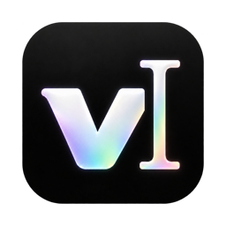
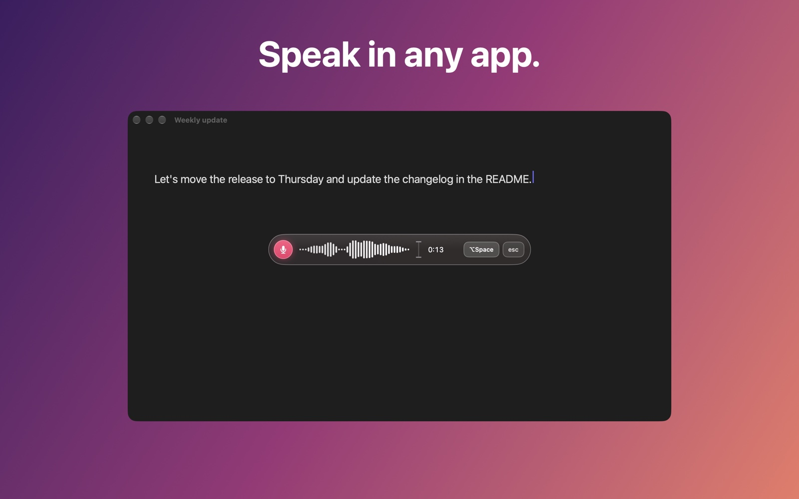
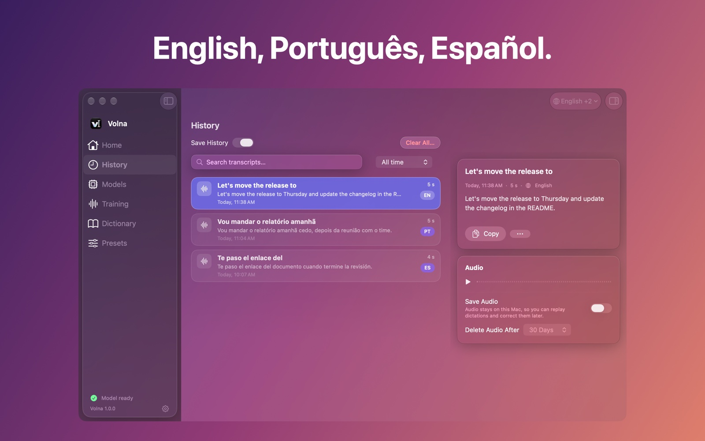
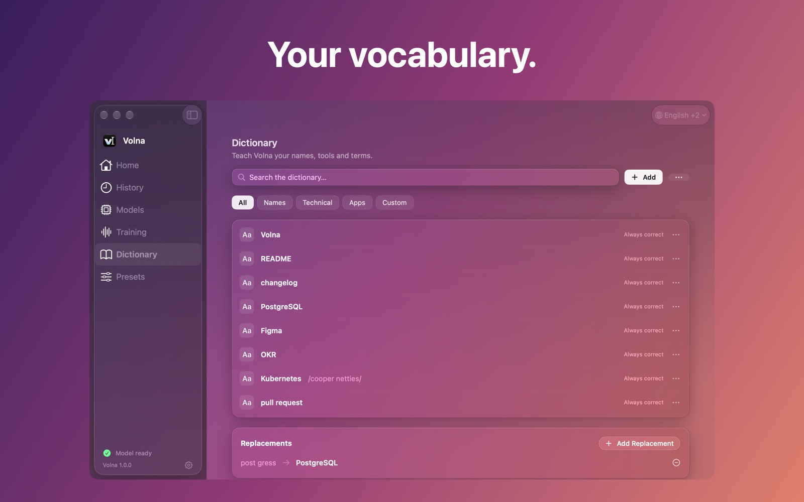

  
  <h1>Volna</h1>
  
<strong>Voice to text for Mac. Speak, and Volna writes it down.</strong> 
  Private, offline dictation: your voice is recognized right on your Mac and never sent anywhere.

  

  
macOS 26 or later · Apple Silicon · Works offline · Free

  
<a href="https://ivolna.com">Website</a> · <a href="https://ivolna.com/privacy">Privacy</a> · <a href="https://ivolna.com/support">Support</a>

## Features

- **Works in any app.** Mail, notes, chats, documents, a code editor or an AI assistant: wherever there is a text field.
- **Fast.** The text appears about a second after you stop speaking.
- **One key.** Tap the right ⌘ to start and stop, in any app. Or use ⌥Space.
- **Several languages.** English, Brazilian Portuguese and Spanish, and nearly a hundred more. Sentences with English terms inside are fine.
- **Your vocabulary.** Teach Volna the names, tools and terms of your work.
- **History.** Every dictation stays on your Mac, ready to copy or reuse.
- **Private by design.** Recognition runs on your Mac. Your voice and your text never leave it.

## How it works

1. **Tap your key:** the right ⌘, or ⌥Space.
2. **Speak naturally.** Pause when you like; Volna listens only while you dictate.
3. **The text appears** right where your cursor is, or on the clipboard if you prefer.

## Install

1. [Download Volna](https://ivolna.github.io/volna-releases/Volna-1.0.6.dmg), open the disk image and drag Volna to Applications.
2. Open Volna. It asks for the Microphone, the only permission it needs, and downloads its speech model once.
3. Optional: allow Accessibility, and Volna types the text in for you. Without it, the text goes to the clipboard and you press ⌘V.

Volna updates itself. Every update is signed by Stillbyte LLC and notarized by Apple.

  
  

## Privacy

Volna recognizes your voice on your Mac. Your audio and your text are never sent anywhere. The internet is used only to download speech models and to check for updates. History stays on your Mac, and you decide what to keep. Read the [privacy policy](https://ivolna.com/privacy).

## FAQ

**Does Volna send my voice anywhere?**
No. Recognition runs on your Mac, and your voice and your text never leave it.

**Which Macs does it run on?**
Macs with Apple Silicon, running macOS 26 or later.

**Which apps does it work in?**
Any app with a text field. With Accessibility allowed, Volna types the text in for you. Without it, the text goes to the clipboard and you press ⌘V.

**Does it work offline?**
Yes, once the speech model is downloaded. Recognition itself needs no internet connection.

**What permissions does it need?**
Only the Microphone is required. The other permissions are optional, and Volna explains what each one is for before you decide.

**How is Volna different from Wispr Flow, superwhisper or MacWhisper?**
Volna always recognizes your voice on your Mac, does one thing (dictation into any app) and is free. See the comparisons on [ivolna.com](https://ivolna.com).

## Support

Questions and bug reports: [ivolna.com/support](https://ivolna.com/support) or [support@ivolna.com](mailto:support@ivolna.com).

---

This repository hosts Volna's downloads and its update feed ([appcast.xml](https://updates.ivolna.com/appcast.xml)). © 2026 Stillbyte LLC.
